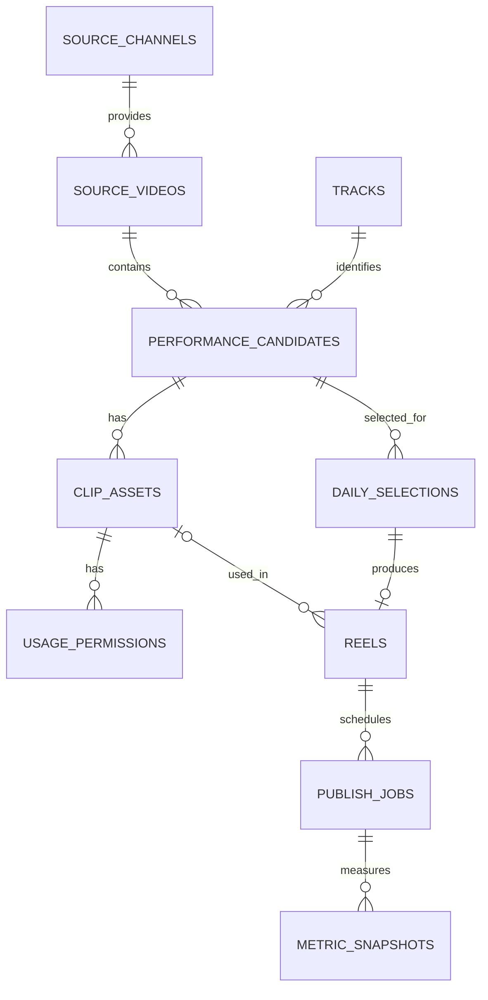

# SECOND TAKE — K-pop Live Versions & Covers 릴스 큐레이션 도구

해외 K팝 팬이 놓친 **공식 라이브·커버·밴드 편곡·어쿠스틱 버전**을 하루 한 편의 인스타그램 릴스로 소개하는 운영 도구입니다.
운영자는 공식 출처, 선곡 기준, 적법하게 확보한 파일과 이용 허락만 등록합니다. 이후 **선곡 → 권한 판정 → 영어 문구 → 9:16 영상 → 예약 발행(드라이런)** 은 자동으로 진행됩니다.

> 이번 범위는 로컬 MVP입니다. 테스트 데이터와 모의 발행으로 검증했고, 실제 공식 채널 수집·Instagram 게시·성과 수집은 후속 연동입니다.
> 계정명 `SECOND TAKE` / `@secondtake.kpop`은 임시 이름이므로 `config/default.json`에서 바꿀 수 있습니다.

---

## 1. 설치·실행

| 필요 | 버전 | 비고 |
|---|---|---|
| Node.js | **22.13 이상** | 내장 SQLite(`node:sqlite`)를 사용합니다. 네이티브 모듈 빌드가 필요 없습니다. |
| FFmpeg / ffprobe | 4.4 이상, `libx264` 포함 | `PATH`에 있어야 합니다. Windows: `winget install Gyan.FFmpeg` |
| 폰트 | 자동 탐지 | Windows: 맑은 고딕 Bold, Linux: Noto Sans CJK, macOS: Apple SD Gothic Neo. 다른 폰트는 `config/local.json`의 `render.fontFile`에서 지정합니다. |

```bash
npm install          # Express 설치. 설치하지 않아도 내장 호환 서버로 동작합니다(아래 참고).
npm run setup        # DB 생성, 테스트 데이터 등록, 자체 제작 테스트 클립 생성
npm run demo         # 시나리오 4개 날짜 실행 → 같은 날짜 재실행(중복 없음 확인) → 상태표 출력
npm start            # http://localhost:3000 로컬 운영 화면
npm run analyze      # 곡 구조 분석 → 클립 구간 추천(제안만 저장, 승인 전 변경 없음)
npm test             # 자동 검증 22개
```

하루 단위 실행:

```bash
npm run run:day -- --date 2026-11-23              # 지정 날짜(생략하면 Asia/Seoul 기준 오늘)
npm run run:day -- --date 2026-11-15 --reselect   # 발행 전 명시적 재선곡(같은 행 갱신, revision+1)
npm run status
node src/cli.js approve --id 1                    # 구간 추천 승인 → 해당 날짜 재실행 시 같은 릴스로 다시 렌더링
node src/cli.js reset --yes                       # 모든 테이블 비우기(파일은 유지)
```

**Express 관련:** 이 프로젝트를 만든 환경에서는 npm 레지스트리 접근이 막혀 있었습니다. 그래서 `express`가 설치되지 않았으면 같은 API를 흉내 내는 `src/web/mini-express.js`로 자동 전환됩니다. 운영 화면 상단 알림으로 어느 쪽으로 실행 중인지 표시됩니다. `npm install` 후에는 실제 Express로 동작합니다. 실제 Express로는 아직 실행해 보지 않았습니다(아래 검증 표 참고).

---

## 2. 전체 파이프라인

```
data/seed/test-candidates.json   (향후: 공식 API 수집기가 같은 구조로 적재)
        │  importJson — (platform, platform_video_id) 등 자연 키로 upsert, 중복 없음
        ▼
[1] 적격성 필터  ─ 이름·곡명·버전 근거 없음 / 해당 날짜에 아직 미공개 / 이미 실제 게시됨 → 제외 (드라이런은 게시로 치지 않음)
        ▼
[2] 점수        ─ 버전 차이 40 · 영어 정보 25 · 소개 시점 20(14일) · 최근 7일 공연자 중복 없음 15
                  동점 → 공식 게시일 최신 → candidate_key 순 (모두 config로 조정)
        ▼
[3] 권한 판정   ─ 클립 후보 우선. footage·music·performance 각각에 대해
                  허락 상태·편집·Instagram 재게시·게시 시점(+30일 유지)·사용 구간·지역(전 세계)을 모두 충족해야 licensed_clip
                  하나라도 빠지면 original_graphic. 적격 후보가 없으면 건너뛰고 이유를 기록
        ▼
[4] 영어 문구   ─ 저장된 데이터만 쓰는 결정적 템플릿(AI 변형은 선택 기능, 기본 꺼짐)
        ▼
[5] 렌더링      ─ JSON 템플릿(templates/reels) → FFmpeg 1080×1920 H.264/AAC MP4 + 포스터 PNG
                  템플릿은 운영 날짜별로 순환. 실패하면 같은 릴스 행에서 이어서 처리
     ↑ (선택) 곡 구조 분석 ─ all-in-one 결과로 클립 구간 추천 → 운영자 승인 → 같은 릴스 다시 렌더링
        ▼
[6] 드라이런 예약 ─ 파일·캡션·예약 시각(UTC)·권한 재확인. 외부 ID와 조회수는 만들지 않음
```

| 단계 | 파일 |
|---|---|
| 스키마 / DB | `src/db/schema.sql`, `src/db/index.js` |
| 입력 | `src/ingest/importJson.js` |
| 선곡 | `src/selection/scoring.js`, `src/selection/selectDaily.js` |
| 권한 판정 | `src/rights/evaluate.js` |
| 문구 | `src/copy/templates.js` |
| 렌더링 | `src/render/renderReel.js`, `src/render/templateEngine.js`, `src/render/ffmpeg.js`, `templates/reels/*.json` |
| 구간 추천 | `src/analysis/structure.js`, `tools/allin1_analyze.py` |
| 발행(드라이런) | `src/publish/dryRun.js` |
| 오케스트레이션 / CLI | `src/pipeline.js`, `src/cli.js` |
| 운영 화면 | `src/web/server.js`, `src/web/public/*` |

---

## 3. ERD



ERD 밖의 보조 테이블이 두 개 있습니다. `segment_suggestions`(CLIP_ASSETS 1:N)는 곡 구조 분석으로 만든 구간 추천을 저장합니다. 상태는 proposed / approved / rejected / superseded 중 하나입니다. `account_metric_snapshots`는 국가별 도달처럼 계정 단위로만 제공되는 지표를 게시물 지표와 분리해 저장합니다.

SQLite에서 실제로 적용되는 제약:

| 규칙 | 구현 |
|---|---|
| 같은 원본 영상 중복 수집 금지 | `source_videos UNIQUE(platform, platform_video_id)` |
| 운영 날짜당 선곡 1개 | `daily_selections UNIQUE(operating_date)` |
| 선곡당 릴스 1개 | `reels UNIQUE(selection_id)` |
| 릴스·플랫폼·모드당 발행 작업 1개 | `publish_jobs UNIQUE(reel_id, platform, mode)` |
| 클립형은 클립 필수, 그래픽형은 클립 없음 | `reels CHECK` |
| 건너뛴 날짜는 이유 필수 | `daily_selections CHECK` |
| 드라이런에 외부 ID 저장 금지 | `publish_jobs CHECK (mode='live' OR external ids IS NULL)` |
| 권한 범주당 1행 | `usage_permissions UNIQUE(clip_asset_id, rights_category)` |
| 외래 키 | `PRAGMA foreign_keys = ON` (열 때 확인) |

시간 규칙: `operating_date`는 Asia/Seoul 기준 달력 날짜이고, `*_at`과 `scheduled_at`은 UTC로 저장합니다. 예를 들어 운영일 2026-11-23의 19:00 KST는 `2026-11-23T10:00:00Z`로 저장됩니다.

---

## 4. 테스트 데이터 사용법

`data/seed/test-candidates.json`에는 **가상의 아티스트·채널과 example.com 링크**만 들어 있습니다. 실존 아티스트의 공식 링크를 꾸며 넣지 않았고, 공식 영상을 다운로드하거나 재업로드하지도 않습니다. 클립 파일은 FFmpeg로 직접 만든 테스트 영상(`storage/test-assets/sample_live_clip.mp4`, 컬러바와 사인파)이고, 권한은 모두 `is_test_permission=1`인 가상 권한입니다.

| 시나리오 날짜 | 기대 결과 | 확인 포인트 |
|---|---|---|
| 2026-09-26 | **건너뜀** | 유일한 공개 후보에 공식 영문 곡명이 없음 → 로마자 표기나 번역을 하지 않고 제외 |
| 2026-11-15 | **그래픽형** (Haneul acoustic cover) | 클립 4개가 각각 만료 / KR 한정 / 구간 불일치 / 음악 권리 누락. 100점 동점 4개 → 공식 게시일이 최신인 후보 선택 |
| 2026-11-16 | **그래픽형** (ORBIT acoustic) | 전날 선택된 Haneul이 최근 7일 중복으로 15점 감점 → 다른 후보로 교체 |
| 2026-11-23 | **클립형** (LUMINA live band) | 권리 3종이 모두 충족된 샘플. 공식 챕터 근거가 있는 `&t=134s` 링크 사용. 실제 발행 경로였다면 테스트 소재라서 차단됨 |

추가 데이터 포인트: 같은 곡(Starlight Avenue)의 라이브(P001·P007)와 커버(P002)는 서로 다른 후보입니다. 한 공식 영상(TEST-SLS-0003)에 두 곡(P004·P005)이 들어 있습니다.

새 후보를 넣을 때는 같은 JSON 형식으로 파일을 만들고 `importFile(db, path)`를 호출하면 됩니다. 권한 증빙은 `evidence://...` 형태의 **참조값만** 저장하고, 원본 문서는 Git에 포함하지 않습니다(`storage/`, `evidence/`는 .gitignore 대상). URL을 `file_ref`에 넣으면 거부됩니다. 공식 링크는 파일이 아니기 때문입니다.

---

## 5. 추가 기능 (v0.2)

### ③ JSON 템플릿
`templates/reels/<id>.json`에 레이아웃을 정의합니다. 요소 종류는 text, pill, label, box, list, clipCues입니다. 위치는 `y`, `gap`, `minY`로, 시간은 `show: [시작, 끝]`이나 `fadeIn`으로 지정합니다. 코드를 고치지 않고 새 포맷을 추가할 수 있습니다.

| 템플릿 | 형식 | 특징 |
|---|---|---|
| `graphic-classic` | 그래픽 | 한 장에 모든 정보가 순서대로 나타남 |
| `graphic-sequence` | 그래픽 | **3장면 전환**: 훅(0–2.8초) → 이 버전을 볼 이유(2.8–5.5초) → 시청 포인트와 공식 링크 안내(5.5–8초). 무음 그래픽이 멈춰 있지 않게 하는 것이 목적 |
| `clip-standard` | 클립 | 16:9 클립을 9:16 가운데에 배치하고, 시청 포인트가 해당 시점에 클립 위로 표시됨 |

`render.templates`에 형식별 목록을 두면 운영 날짜 순서대로 돌아가며 쓰고, 사용한 템플릿은 `reels.template_id`에 기록됩니다.

### ② 근거가 있는 시점별 텍스트 (`watch_cues`)
후보마다 `[{at_sec, text_en, evidence}]` 형식으로 공식 영상의 시청 포인트를 저장합니다. **근거(evidence)가 없으면 가져오기 단계에서 거부합니다.** 등록된 포인트는 캡션의 "Moments to watch" 목록, 그래픽형 3장면의 목록, 클립형 화면의 시점별 표시에 쓰입니다.

### ① 곡 구조 분석으로 클립 구간 추천 (all-in-one)
- `npm run analyze`를 실행하면 클립 파일별 분석 결과를 가져옵니다. 순서는 캐시(`storage/analysis`) → all-in-one 실행(설정에서 켠 경우) → 픽스처(**TEST 소재 전용**)입니다.
- 추천은 **허락된 구간(권리 3종 모두의 교집합) 안에서만** 만들고, chorus > solo > bridge > verse > inst 순서로 고릅니다. 시작과 끝은 **마디 첫 박(downbeat)에 맞추고**, 길이는 8–30초입니다.
- 권리가 불완전하면 추천하지 않습니다(A005). 허락 구간 안에 맞는 섹션이 없어도 추천하지 않습니다(A004).
- **운영자가 승인해야만** 클립 구간이 바뀝니다. 승인하면 해당 날짜를 다시 실행해 같은 릴스 행에서 다시 렌더링하고, 권리도 다시 확인합니다. 실제 발행(live) 작업이 있는 클립은 변경할 수 없습니다.
- 분석으로 얻은 구간은 공식 타임스탬프가 아니므로 캡션의 `▶ 시점`에는 쓰지 않습니다.

**all-in-one 설치(사용자 환경, 실행은 아직 확인 안 함):** Linux 또는 WSL2를 권장합니다. Windows는 NATTEN을 소스에서 빌드해야 합니다.
```bash
pip install torch                                   # pytorch.org에서 환경에 맞는 빌드
# NATTEN 설치 — all-in-one README 참고
pip install git+https://github.com/CPJKU/madmom
pip install allin1
```
그다음 `config/local.json`에 `{"analysis":{"allin1":{"enabled":true,"pythonPath":"python3"}}}`를 넣습니다(Windows는 `"python"`).

`data/seed/analysis/sample_live_clip.allin1.json`은 **사람이 직접 쓴 픽스처이며 실제 모델 결과가 아닙니다.** TEST 소재에만 쓰이고, 화면에도 "픽스처" 배지로 표시됩니다.

## 6. 실제 검증한 것 (2026-11-22)

| 항목 | 방법 | 결과 |
|---|---|---|
| ① 같은 곡의 라이브·커버가 별도 후보로 저장됨 | `npm test` 1, 1b | ✅ |
| ② 허락 샘플은 클립형, 누락·만료·지역·구간 불일치는 그래픽형 | `npm test` 2, 2b | ✅ |
| ③ 유효 후보가 없으면 건너뛰고 이유 기록 | `npm test` 3 | ✅ |
| ④ 영어 제목·캡션, 공식 링크, 9:16 MP4 | `npm test` 4, 4b. ffprobe로 1080×1920 h264/yuv420p/aac 확인, 포스터 프레임은 눈으로 확인 | ✅ **실제 MP4 생성까지 확인** |
| ⑤ 같은 날짜를 재실행해도 선곡·릴스·드라이런 중복 없음, 실패한 렌더링 이어 처리, 재선곡 | `npm test` 5, 5b, 5c, `npm run demo` 재실행 구간 | ✅ |
| ⑥ 로컬 화면에서 후보부터 최종 결과까지 시연 | `npm test` 6(API·영상 서빙·안내 페이지), 화면 캡처 확인 | ✅ (내장 호환 서버 기준) |
| 템플릿 3종 렌더링, 날짜별 순환, 장면 전환 타이밍 | `npm test` templates 3개, 프레임 캡처 확인 | ✅ |
| 시점 텍스트: 근거 없는 항목 거부, 캡션·화면 반영 | `npm test` cues | ✅ |
| 구간 추천: 마디에 맞춘 컷, 허락 구간 준수, 권리 미비 시 추천 없음, 승인 → 같은 릴스 다시 렌더링(22초 → 16초) | `npm test` analysis 3개, 화면에서 승인 버튼 클릭 확인 | ✅ (**픽스처 기준**) |
| all-in-one 실제 모델 실행과 정확도 | — | ⚠️ 미확인. PyTorch와 allin1을 설치할 수 없는 환경이었음. K팝 라이브 음원에서 코러스를 잘못 잡을 가능성이 있어 승인 단계를 둠 |
| 실제 Express 구동 | — | ⚠️ 미확인 (npm 설치 불가 환경). `npm install` 후 `npm start`로 확인 필요 |
| Windows 경로·폰트 | — | ⚠️ 미확인. 리눅스(한글·공백이 들어간 경로)에서만 렌더링을 검증함 |

---

## 7. 남은 연동 (이번 범위 밖)

1. **공식 채널 수집**: YouTube Data API 등으로 `source_videos`를 수집합니다. 챕터 파싱 결과는 `segment_evidence`가 있을 때만 타임스탬프로 사용하고, 이름과 버전 근거 추출은 운영자 확인 단계를 거칩니다.
2. **Instagram 발행**: 구현하기 전에 최신 Meta 공식 문서에서 계정 유형(비즈니스·크리에이터), 필요한 권한, 릴스 미디어 형식, 음원 처리, 예약 게시 지원 여부, 인사이트 제공 범위를 확인해야 합니다. 이 MVP는 그 내용을 확인하지 않았고, 해당 기능을 가정한 코드도 넣지 않았습니다. `mode: 'live'`를 지정하면 명시적으로 실패합니다.
   - 중복 발행 방지: (reel, platform, mode) 고유 제약 → 재시도 전에 기존 컨테이너·미디어 ID로 상태 확인 → 판별할 수 없으면 `pending_confirmation`으로 두고 자동 재시도 금지
3. **성과 수집**: `metric_snapshots`에 24시간·7일 기준으로 기록하고, 클립형과 그래픽형을 나눠 비교합니다. 게시물 단위로 제공되지 않는 값은 NULL로 두고, 국가별 도달은 `account_metric_snapshots`에 저장합니다.
4. **AI 문구 변형**: `aiVariation()` 훅만 있고 기본값은 꺼져 있습니다. 이름·곡명·링크는 그대로 유지해야 합니다.
5. **실제 권리 확보 프로세스**: 영상(방송사·채널), 음악(작사·작곡·퍼블리셔), 실연(아티스트·기획사) 권리를 각각 확보해야 합니다. 현실적으로 가장 오래 걸리는 부분입니다.

---

## 8. 설계상 판단과 한계

- **"조회수를 빠르게 확보"와 "권리 기반 운영"은 서로 부딪힙니다.** 공식 공연 클립의 3종 권리를 확보하기 전까지는 대부분 그래픽형(무음 + 텍스트)으로 나갑니다. 무음 텍스트 릴스는 일반적으로 공연 영상보다 시청 지속률이 낮을 가능성이 큽니다. 그래서 운영 지표는 클립형과 그래픽형을 반드시 따로 비교하도록 설계했습니다. 그래픽형의 도달이 낮다면, 그것은 이 도구의 실패가 아니라 권리 확보가 병목이라는 신호입니다.
- 3장면 템플릿과 시점 텍스트는 그래픽형이 넘겨지는 비율을 줄이는 방향의 개선입니다. 하지만 무음이라는 본질은 그대로라 공연 클립형과의 격차를 메우지는 못합니다. 효과는 실제 발행 후 평균 시청 시간으로 확인해야 합니다.
- 그래픽형에는 음원을 넣지 않았습니다. Instagram 앱 안의 음원 라이브러리를 쓰려면 앱에서 직접 게시해야 할 수 있는데, 이 부분은 Meta 문서로 확인해야 합니다.
- "왜 볼 만한가" 한 줄은 근거(`why_watch_evidence`)가 있을 때만 그 문구를 씁니다. 근거가 없으면 사실만으로 만든 문장으로 대체합니다(예: "A live band version of Rainfall from Seoul Live Sessions."). 사람이 쓴 한 줄보다 약하기 때문에, 실운영에서는 운영자가 이 필드를 채우는 것이 품질을 좌우합니다.
- 권한은 게시 시점 + 30일 이상 유효해야 통과합니다(`rights.minDaysValidAfterPublish`). 게시물은 계속 노출되기 때문입니다. 실제 계약 조건에 맞춰 조정하면 됩니다.
- Instagram에 지역별 공개 제한 기능이 있는지 확인되지 않았으므로 `geoRestrictionSupported: false`로 두고 전 세계 허락만 인정합니다.
- 참고 계정(오프뮤직·Musix Lab·music.lyrics.def)에서는 원칙만 가져왔습니다. 이름·레이아웃·그래픽은 독자적으로 설계했고, 각 계정 페이지는 로그인이 필요해 직접 열어 보지 않았습니다.
